

  <a href="https://github.com/BryanOnKeys">
    
  </a>

  

<b>@BryanOnKeys</b>

  

  <a href="#about">Sobre mí</a> &nbsp; / &nbsp;
  <a href="#projects">Proyectos</a> &nbsp; / &nbsp;
  <a href="#stats">GitHub</a> &nbsp; / &nbsp;
  <a href="#connect">Conectemos</a>



Me interesa resolver problemas construyendo software que tenga sentido por dentro y por fuera: **decisiones técnicas comprensibles, reglas de negocio consistentes e interfaces fáciles de utilizar**. Aprendo con proyectos, documentación y práctica constante.


<i>Construir algo útil. Entender cómo funciona. Mejorarlo en cada iteración.</i>

  <a href="#about"></a>
  <a href="#stack"></a>

  <a href="#focus"></a>
  <a href="#projects"></a>

  <a href="#stats"></a>
  <a href="#activity"></a>

  <a href="#contributions"></a>
  <a href="#connect"></a>




<b>Mi base técnica y lo que sigo reforzando</b>

- **Base:** Java, Spring Boot, JavaScript, TypeScript, React y bases de datos relacionales.
- **Aplicado en NEXO:** NestJS, MikroORM, PostgreSQL, DDD, WebSockets, contenedores y flujos asíncronos con SNS/SQS, S3 y Secrets Manager.
- **En aprendizaje:** retomar C#/.NET, profundizar en testing y llevar despliegues a AWS real.
- **Herramientas adicionales:** Maven, Bootstrap, VS Code, Eclipse, Visual Studio y PowerShell; fundamentos de MongoDB.

Estas tecnologías representan formación y práctica en proyectos. El alcance y las comprobaciones de cada proyecto están documentados en su repositorio.



<b>Cómo abordo un proyecto</b>

1. Entender el problema y delimitar un cambio que se pueda explicar y revisar.
2. Seguir el recorrido desde la interfaz y la API hasta el dominio y los datos.
3. Cuidar permisos, validaciones, consistencia y fallos parciales.
4. Comprobar el comportamiento con pruebas, revisar el diff y documentar las decisiones.
5. Evaluar críticamente las sugerencias de IA y pedir contexto cuando el riesgo aumenta.


  <a href="https://github.com/BryanOnKeys/nexo-fulfillment"></a>

**[NEXO Fulfillment ↗](https://github.com/BryanOnKeys/nexo-fulfillment)** conecta tres microservicios con reservas transaccionales, PDFs y notificaciones. Incluye autenticación, roles, outbox/inbox, pruebas de integración, Docker y Terraform. **[Ver CI](https://github.com/BryanOnKeys/nexo-fulfillment/actions/workflows/ci.yml)** · **[Arquitectura](https://github.com/BryanOnKeys/nexo-fulfillment/blob/main/docs/arquitectura.md)**.

  <a href="https://github.com/BryanOnKeys/borough-ledger-crm"></a>

**[Borough & Ledger CRM ↗](https://github.com/BryanOnKeys/borough-ledger-crm)** combina una aplicación React con servicios Spring Boot y persistencia relacional para gestión comercial.

  <a href="https://github.com/BryanOnKeys/web-petshop"></a>

**[Patitas Felices ↗](https://github.com/BryanOnKeys/web-petshop)** es un proyecto de frontend con vistas navegables y componentes reutilizables para una tienda de mascotas.

<a href="https://github.com/BryanOnKeys?tab=repositories"><b>Explorar todos mis repositorios ↗</b></a>


<a href="https://github.com/BryanOnKeys?tab=overview"></a>


Tarjetas generadas en este repositorio a partir de datos públicos de GitHub. Los repositorios públicos incluyen forks; el gráfico de lenguajes los excluye.




<a href="https://github.com/BryanOnKeys?tab=overview"></a>

<b>Ver también mi animación de Pac-Man</b>

 
<picture>
  <source media="(prefers-color-scheme: dark)" srcset="https://raw.githubusercontent.com/BryanOnKeys/BryanOnKeys/output/pacman-contribution-graph-dark.svg" />
  <source media="(prefers-color-scheme: light)" srcset="https://raw.githubusercontent.com/BryanOnKeys/BryanOnKeys/output/pacman-contribution-graph.svg" />
  
</picture>

[Ver el workflow de la animación ↗](https://github.com/BryanOnKeys/BryanOnKeys/actions/workflows/pacman.yml)


Me interesa compartir lo que aprendo, recibir feedback y colaborar en proyectos que resuelvan problemas concretos. Puedes explorar mis repositorios y sus conversaciones públicas.

  <a href="https://github.com/BryanOnKeys"></a>
  <a href="https://www.linkedin.com/in/bryanonkeys"></a>

<a href="#inicio"></a>

<a href="./DESIGN.md">Sobre el diseño y la actualización de este perfil</a>

