<!--
  BRYANONKEYS // VOLUMETRIC PROFILE
  Original SVG scenes generated locally from public GitHub data.
  No copy of unlicensed artwork from other profiles.
-->

  <a href="https://github.com/BryanOnKeys">
    
  </a>

  <a href="#user-content-about">Sobre mí</a> ·
  <a href="#user-content-stack">Stack</a> ·
  <a href="#user-content-orbit">Órbita</a> ·
  <a href="#user-content-projects">Proyectos</a> ·
  <a href="#user-content-stats">Estadísticas</a> ·
  <a href="#user-content-oss">Open Source</a> ·
  <a href="#user-content-contributions">Contribuciones</a>

<h2 align="left">01 · Sobre mí</h2>


Trabajo en aplicaciones que conectan interfaces, servicios y datos. Me interesan las reglas de negocio claras, las APIs bien diseñadas, el trabajo colaborativo y el código mantenible.

<h2 align="left">02 · Tech Stack · Arquitectura isométrica</h2>


<b>Explorar herramientas y tecnologías</b>

**Backend:** Java, Spring Boot, Spring Security, NestJS, TypeScript y APIs REST.

**Frontend:** React, JavaScript, TypeScript, HTML, CSS, Tailwind y Vite.

**Datos:** PostgreSQL, MySQL, SQL Server, MikroORM y Spring Data JPA.

**Entorno:** Docker, Git, GitHub Actions, Postman y servicios AWS utilizados en proyectos.

<h2 align="left">03 · Órbita del ecosistema</h2>


El gráfico de lenguajes se calcula por bytes de código, no representa un porcentaje de conocimientos.

<h2 align="left">04 · Proyectos · Modelos tridimensionales</h2>

<a href="https://github.com/BryanOnKeys/nexo-fulfillment"></a>

<a href="https://github.com/BryanOnKeys/borough-ledger-crm"></a>

<a href="https://github.com/BryanOnKeys/web-petshop"></a>

<a href="https://github.com/BryanOnKeys?tab=repositories"><b>Ver todos los repositorios</b></a>

<h2 align="left">05 · GitHub · Datos tridimensionales</h2>


<a href="https://github.com/BryanOnKeys/nexo-fulfillment/actions/workflows/ci.yml">CI de NEXO</a> · <a href="https://github.com/BryanOnKeys/nexo-fulfillment/blob/main/docs/arquitectura.md">Arquitectura de NEXO</a>

<h2 align="left">06 · Contribuciones Open Source</h2>


<a href="https://github.com/BryanOnKeys/duo">duo</a> · <a href="https://github.com/BryanOnKeys/pqc-migration-readiness">pqc-migration-readiness</a> · <a href="https://github.com/BryanOnKeys/deadcode-hunter">deadcode-hunter</a>

Estos repositorios son forks o espacios de contribución y no se presentan como proyectos creados desde cero.

<h2 align="left">07 · Contribution City · Actividad real</h2>


<b>Animación 3D alternativa y otros modelos</b>

El workflow <a href="https://github.com/BryanOnKeys/BryanOnKeys/actions/workflows/3d-contributions.yml">GitHub Profile 3D Contrib</a> genera otros modelos 3D y variantes de color mediante GitHub Actions. Los archivos generados aparecerán en <a href="https://github.com/BryanOnKeys/BryanOnKeys/tree/main/profile-3d-contrib">profile-3d-contrib</a> después de que la ejecución finalice correctamente.

<a href="https://honzaap.github.io/GithubCity?name=BryanOnKeys">Explorar una ciudad 3D interactiva basada en GitHub</a>

<h2 align="left">08 · Conectemos</h2>

  
  

<a href="#user-content-top"></a>

Visualizaciones SVG originales, generadas desde datos públicos del repositorio. El 3D interactivo necesita abrir una web externa; GitHub renderiza las escenas dentro del README como imágenes.
