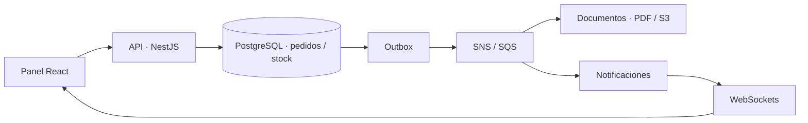
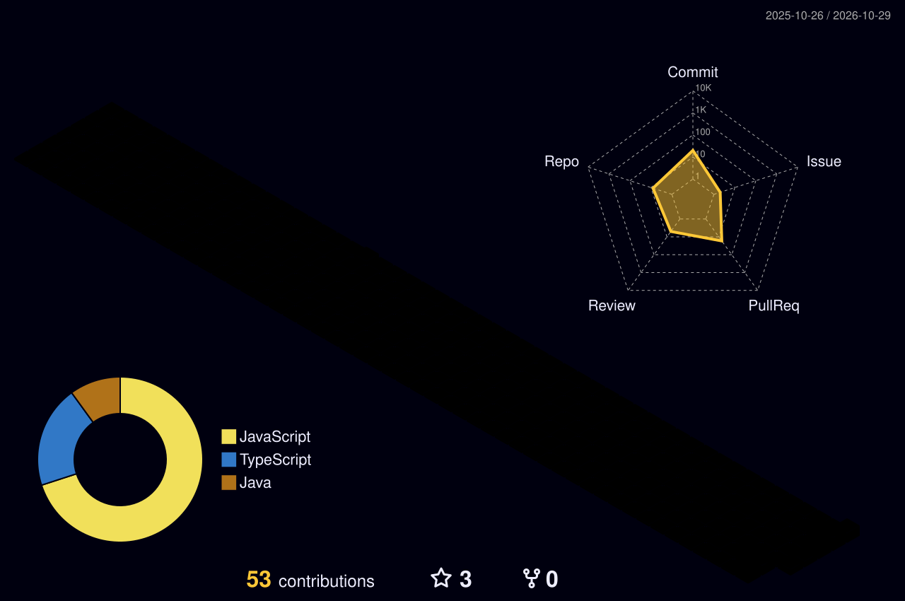
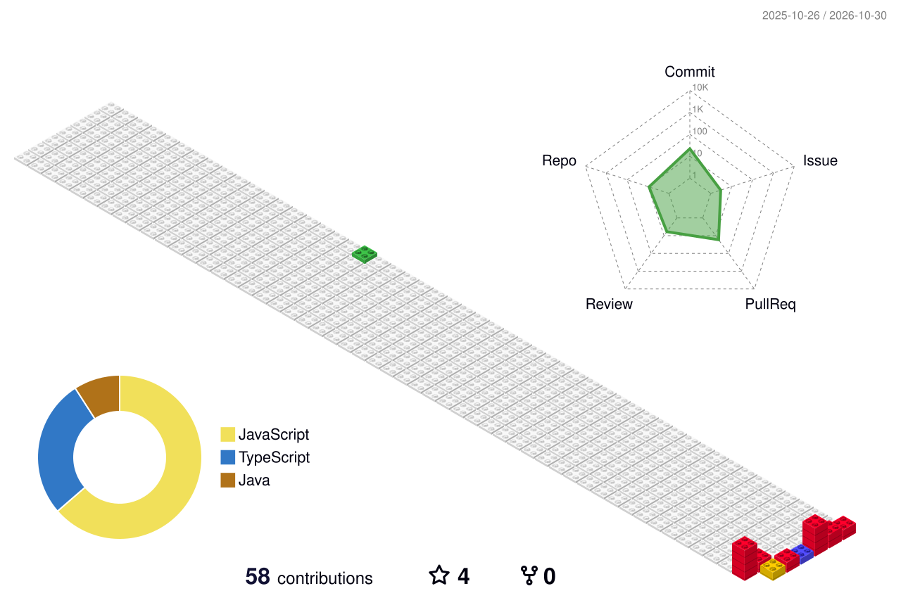
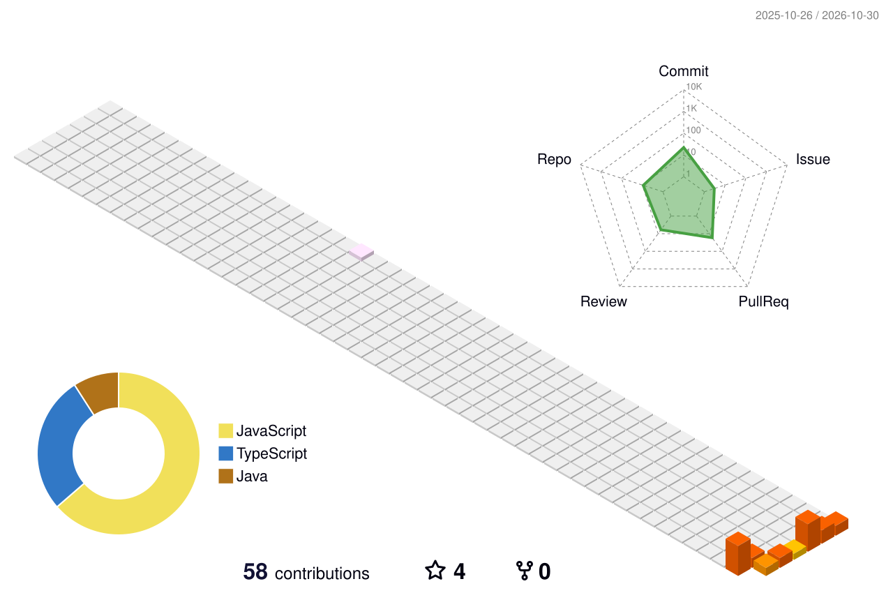

# BryanOnKeys

**Software Developer · Backend Engineering · Aplicaciones web**

Desarrollo aplicaciones con especial atención a la lógica de negocio, la seguridad de las APIs y la persistencia de datos. Trabajo principalmente con **Java, Spring Boot, TypeScript y NestJS**; también construyo interfaces con **React**. Mi código y mis decisiones de arquitectura pueden revisarse en los repositorios públicos.

[Proyectos](#proyectos) · [Arquitectura](#arquitectura-y-decisión-técnica) · [Código real](#código-real) · [Contribuciones](#contribuciones-3d) · [LinkedIn](https://www.linkedin.com/in/bryanonkeys)

---

## Tecnologías aplicadas

| Área | Herramientas | Evidencia |
| --- | --- | --- |
| **Backend** | Java 25, Spring Boot 4, NestJS, TypeScript, REST | [CRM](https://github.com/BryanOnKeys/borough-ledger-crm) · [NEXO](https://github.com/BryanOnKeys/nexo-fulfillment) |
| **Frontend** | React, JavaScript, TypeScript, HTML/CSS, Vite, Tailwind | [Patitas Felices](https://github.com/BryanOnKeys/web-petshop) · [CRM](https://github.com/BryanOnKeys/borough-ledger-crm) |
| **Datos** | PostgreSQL, MySQL, SQL Server, MikroORM, JPA | [Persistencia NEXO](https://github.com/BryanOnKeys/nexo-fulfillment/tree/main/apps/operations) · [CRM](https://github.com/BryanOnKeys/borough-ledger-crm/tree/main/backend) |
| **Calidad y operaciones** | Git, Docker, GitHub Actions, pruebas, documentación | [CI NEXO](https://github.com/BryanOnKeys/nexo-fulfillment/actions/workflows/ci.yml) · [CI CRM](https://github.com/BryanOnKeys/borough-ledger-crm/actions/workflows/ci.yml) |

## Proyectos

### 01 / [NEXO Fulfillment](https://github.com/BryanOnKeys/nexo-fulfillment) — Backend distribuido

Sistema para pedidos, inventario y despachos, con servicios separados de operaciones, documentos y notificaciones.

- **Reglas de negocio:** reservas transaccionales de stock, control de estados y creación idempotente de pedidos.
- **Integración:** eventos de dominio, outbox/inbox, colas, documentos PDF y notificaciones por WebSockets.
- **Entrega:** contenedores Docker, configuración de infraestructura, pruebas y documentación de arquitectura.

[Ver implementación de pedidos](https://github.com/BryanOnKeys/nexo-fulfillment/blob/main/apps/operations/src/application/orders.service.ts) · [Documentación](https://github.com/BryanOnKeys/nexo-fulfillment/blob/main/docs/arquitectura.md) · [Pruebas](https://github.com/BryanOnKeys/nexo-fulfillment/tree/main/test) · [Pipeline](https://github.com/BryanOnKeys/nexo-fulfillment/actions/workflows/ci.yml)

[](https://github.com/BryanOnKeys/nexo-fulfillment/actions/workflows/ci.yml)

### 02 / [Borough & Ledger CRM](https://github.com/BryanOnKeys/borough-ledger-crm) — Java y aplicaciones empresariales

CRM modular con clientes, contactos, prospectos, oportunidades, cotizaciones, tareas, reportes y auditoría.

- **Backend:** Java 25, Spring Boot 4, servicios transaccionales y separación por organización.
- **Datos:** MySQL, migraciones Flyway, consultas paginadas y trazabilidad.
- **Interfaz:** React y TypeScript, con módulos conectados a la API.

[Ver servicio de clientes](https://github.com/BryanOnKeys/borough-ledger-crm/blob/main/backend/src/main/java/com/boroughledger/crm/customers/CustomerService.java) · [Pruebas](https://github.com/BryanOnKeys/borough-ledger-crm/tree/main/backend/src/test) · [CI](https://github.com/BryanOnKeys/borough-ledger-crm/actions/workflows/ci.yml)

[](https://github.com/BryanOnKeys/borough-ledger-crm/actions/workflows/ci.yml)

### 03 / [Patitas Felices](https://github.com/BryanOnKeys/web-petshop) — Frontend

Proyecto de experiencia web para una tienda de mascotas, organizado mediante rutas, vistas, componentes reutilizables y estilos responsivos. **Su alcance es frontend**: no se presenta como una tienda con pagos o backend productivo.

[Ver rutas React](https://github.com/BryanOnKeys/web-petshop/blob/main/src/routes/Index.jsx) · [Componentes](https://github.com/BryanOnKeys/web-petshop/tree/main/src/components) · [Código fuente](https://github.com/BryanOnKeys/web-petshop)

## Arquitectura y decisión técnica

En NEXO, la reserva de stock se confirma en una transacción. El evento de integración queda registrado mediante outbox para su posterior publicación. Los servicios consumidores gestionan sus propios estados e inbox, evitando depender de una transacción distribuida entre bases de datos.



El esquema describe componentes implementados y contratos del proyecto, no un despliegue AWS público certificado. [Consultar decisiones y límites](https://github.com/BryanOnKeys/nexo-fulfillment/blob/main/docs/arquitectura.md).

## Código real

Los siguientes fragmentos proceden de los repositorios enlazados. No son ejemplos inventados para el perfil.

<details>
<summary><b>TypeScript / NestJS — deduplicación de pedidos mediante clave idempotente</b></summary>

```typescript
return this.store.transaction(async (tx) => {
  const prior = await tx.lockRequest(actor.sub, key);
  if (prior) {
    invariant(
      prior.requestHash === requestHash,
      'IDEMPOTENCY_CONFLICT',
      'Esta clave ya se utilizó con otros datos.',
    );
    const order = await tx.order(prior.orderId);
    invariant(order, 'ORDER_NOT_FOUND', 'Pedido no encontrado.', 404);
    return snapshot(order, await tx.items(order.id));
  }
  // Continúa la creación transaccional del pedido...
});
```

**Qué resuelve:** dos solicitudes con la misma clave y contenido no generan dos pedidos; utilizar la misma clave con datos distintos produce un conflicto. [Ver método completo](https://github.com/BryanOnKeys/nexo-fulfillment/blob/main/apps/operations/src/application/orders.service.ts).

</details>

<details>
<summary><b>Java / Spring Boot — aislamiento de clientes por organización</b></summary>

```java
private Customer find(AppUser actor, UUID id) {
    return customers.findByIdAndOrganizationIdAndArchivedAtIsNull(
        id, actor.getOrganizationId()
    ).orElseThrow(() -> new ResponseStatusException(
        HttpStatus.NOT_FOUND, "Cliente no encontrado"
    ));
}
```

**Qué resuelve:** la consulta filtra por organización y excluye clientes archivados, sin revelar la existencia de registros de otra organización. [Ver código completo](https://github.com/BryanOnKeys/borough-ledger-crm/blob/main/backend/src/main/java/com/boroughledger/crm/customers/CustomerService.java).

</details>

<details>
<summary><b>React — organización de rutas por funcionalidades</b></summary>

```jsx
<Routes>
  <Route path="/" element={<Home />} />
  <Route path="/products/cat" element={<ProductsCat />} />
  <Route path="/cart" element={<Cart />} />
  <Route path="/profile" element={<Profile />} />
</Routes>
```

**Qué muestra:** separación de vistas y navegación de una aplicación React. [Ver en el proyecto](https://github.com/BryanOnKeys/web-petshop/blob/main/src/routes/Index.jsx).

</details>

## Actividad pública

Este apartado **se genera desde código** mediante [GitHub Actions](https://github.com/BryanOnKeys/BryanOnKeys/actions/workflows/profile.yml) y un [script de Node.js](https://github.com/BryanOnKeys/BryanOnKeys/blob/main/scripts/profile/render_readme.mjs). No introduce visitas, commits, estrellas ni actividad ficticia.

<!-- PROFILE_LIVE:START -->
**Actividad verificable** · Instantánea pública: `2026-10-30` (UTC)

| Contribuciones (últimos 12 meses) | Repositorios públicos | Proyectos propios públicos | Estrellas en esos repositorios | Seguidores |
| :---: | :---: | :---: | :---: | :---: |
| **58** | **10** | **5** | **4** | **4** |

<details>
<summary>Últimos eventos públicos registrados</summary>

| Fecha | Repositorio | Evento |
| --- | --- | --- |
| 2026-10-28 | [`BryanOnKeys`](https://github.com/BryanOnKeys/BryanOnKeys) | Código actualizado |
| 2026-10-28 | [`BryanOnKeys`](https://github.com/BryanOnKeys/BryanOnKeys) | Código actualizado |
| 2026-10-28 | [`BryanOnKeys`](https://github.com/BryanOnKeys/BryanOnKeys) | Código actualizado |

</details>

<sub>Las contribuciones proceden del calendario público de GitHub. Los eventos disponibles dependen de la ventana de la API; estas cifras no son una medición de habilidad o productividad.</sub>
<!-- PROFILE_LIVE:END -->

## Contribuciones 3D

Mantengo la visualización de **[Yoshi — GitHub Profile 3D Contrib](https://github.com/yoshi389111/github-profile-3d-contrib)**, que transforma el historial de contribuciones en un gráfico tridimensional generado a partir de GitHub.

<p align="center">
  
</p>

<details>
<summary><b>Explorar otras vistas 3D generadas desde el mismo calendario</b></summary>

<p align="center">
  
  
</p>

[Ver todas las variantes disponibles](https://github.com/BryanOnKeys/BryanOnKeys/tree/main/profile-3d-contrib) · [Workflow](https://github.com/BryanOnKeys/BryanOnKeys/actions/workflows/3d-contributions.yml)

</details>

## Colaboración y código abierto

Además de mis proyectos, participo en conversaciones técnicas y contribuciones a repositorios de terceros. Los siguientes son **forks públicos**, no proyectos originales de mi autoría:

[duo](https://github.com/BryanOnKeys/duo) · [deadcode-hunter](https://github.com/BryanOnKeys/deadcode-hunter) · [pqc-migration-readiness](https://github.com/BryanOnKeys/pqc-migration-readiness)

## Contacto

[**GitHub**](https://github.com/BryanOnKeys) · [**LinkedIn**](https://www.linkedin.com/in/bryanonkeys) · [**Explorar repositorios**](https://github.com/BryanOnKeys?tab=repositories)

<sub>Este README prioriza evidencia técnica, decisiones de implementación y proyectos verificables. Los gráficos 3D son la única sección visual externa; las demás visualizaciones provienen de Markdown y código.</sub>
