<!-- Diseño original para BryanOnKeys · inspirado en la composición del perfil de AbdullahBakir97. -->

<i>Construir software útil. Comprender sus decisiones. Mejorarlo en cada iteración.</i>

<a href="#user-content-about"></a>
<a href="#user-content-stack"></a>
<a href="#user-content-focus"></a>
<a href="#user-content-highlights"></a>

<a href="#user-content-stats"></a>
<a href="#user-content-activity"></a>
<a href="#user-content-releases"></a>
<a href="#user-content-projects"></a>

<a href="#user-content-quality"></a>
<a href="#user-content-contributions"></a>
<a href="#user-content-connect"></a>
<a href="#user-content-guestbook"></a>


<b>Ver todo el stack</b> · Backend / Frontend / Datos / Herramientas

 

<b>Cómo trabajo</b> · Arquitectura, seguridad y revisión de cambios

 
Busco entender el problema, diseñar responsabilidades claras, validar datos en el servidor y documentar decisiones. En proyectos personales y contribuciones open source, priorizo pruebas verificables y cambios revisables.



Este panel es una instantánea con fecha de corte; las estadísticas generales inferiores se actualizan automáticamente.

Los lenguajes indican composición de repositorios, no porcentaje de dominio profesional.




<a href="https://github.com/BryanOnKeys/nexo-fulfillment/releases"><b>NEXO · Releases</b></a> · <a href="https://github.com/BryanOnKeys/nexo-fulfillment/commits/main"><b>NEXO · Commits</b></a> · <a href="https://github.com/BryanOnKeys/borough-ledger-crm/commits/main"><b>CRM · Historial</b></a>

<h3 align="center">Proyecto principal</h3>

<h3 align="center">Más proyectos</h3>

<a href="https://github.com/BryanOnKeys/web-petshop"></a>

<b>Índice de proyectos</b> · Qué construí y con qué tecnologías

 
| Repositorio | Tecnologías | Enfoque |
|---|---|---|
| [NEXO Fulfillment](https://github.com/BryanOnKeys/nexo-fulfillment) | NestJS, TypeScript, PostgreSQL, Docker | Pedidos, inventario, documentos, eventos y arquitectura |
| [Borough & Ledger CRM](https://github.com/BryanOnKeys/borough-ledger-crm) | Java, Spring Boot, React, MySQL | Gestión comercial, API e interfaz web |
| [Patitas Felices](https://github.com/BryanOnKeys/web-petshop) | React, JavaScript, Vite | Interfaz y componentes reutilizables |

<a href="https://github.com/BryanOnKeys?tab=repositories"><b>Ver todos mis repositorios ↗</b></a>

<a href="https://github.com/BryanOnKeys/nexo-fulfillment/actions/workflows/ci.yml"><b>Pipeline CI de NEXO</b></a> · <a href="https://github.com/BryanOnKeys/nexo-fulfillment/blob/main/docs/arquitectura.md"><b>Decisiones de arquitectura</b></a> · <a href="https://github.com/BryanOnKeys/BryanOnKeys/actions/workflows/profile.yml"><b>Actualización de este perfil</b></a>

La representación tridimensional conserva las cantidades del período indicado en la tarjeta.

<b>Ver Pac-Man</b> · Mi calendario animado de contribuciones

 
<picture>
<source media="(prefers-color-scheme: dark)" srcset="https://raw.githubusercontent.com/BryanOnKeys/BryanOnKeys/output/pacman-contribution-graph-dark.svg"/>
<source media="(prefers-color-scheme: light)" srcset="https://raw.githubusercontent.com/BryanOnKeys/BryanOnKeys/output/pacman-contribution-graph.svg"/>

</picture>

<a href="https://github.com/BryanOnKeys/BryanOnKeys/issues/new?template=guestbook.yml"></a><a href="https://github.com/BryanOnKeys/BryanOnKeys/issues?q=is%3Aissue+%22%5BVisita%5D%22"></a>

Los mensajes se publican como issues del repositorio; no hay formularios externos ni recopilación adicional de datos.

<a href="./DESIGN.md">Diseño y origen de los datos</a> · <a href="./THIRD_PARTY_NOTICES.md">Licencias</a>

