<!--
  Perfil de GitHub de BryanOnKeys.
  Composición cinematográfica original inspirada en el estilo de visualización
  de AbdullahBakir97. Los datos, proyectos y métricas son de BryanOnKeys.
  SVG autorregenerados por scripts/profile/cinematic.mjs.
-->

  

  <a href="https://github.com/BryanOnKeys"></a>

  

  

  
  
  

  
  
  

<i>“Build software that matters. Understand it. Improve it.”</i>


<a href="#user-content-about"></a>
<a href="#user-content-skills"></a>
<a href="#user-content-focus"></a>
<a href="#user-content-highlights"></a>

<a href="#user-content-stats"></a>
<a href="#user-content-activity"></a>
<a href="#user-content-releases"></a>
<a href="#user-content-projects"></a>

<a href="#user-content-quality"></a>
<a href="#user-content-contributions"></a>
<a href="#user-content-connect"></a>
<a href="#user-content-guestbook"></a>



  
<b>See the full stack</b> · Java, Spring Boot, NestJS, React, PostgreSQL, Docker y más

   
  

  


  <a href="https://github.com/BryanOnKeys/nexo-fulfillment"><b>NEXO Fulfillment</b></a> ·
  <a href="https://github.com/BryanOnKeys/borough-ledger-crm"><b>Borough & Ledger CRM</b></a> ·
  <a href="https://github.com/BryanOnKeys/web-petshop"><b>Patitas Felices</b></a> ·
  <a href="https://github.com/BryanOnKeys/duo"><b>duo (fork)</b></a>

Datos públicos que se actualizan diariamente. Los porcentajes de lenguajes representan bytes de código, no nivel de habilidad.



<a href="https://github.com/BryanOnKeys/nexo-fulfillment/releases"><b>NEXO Releases</b></a> · <a href="https://github.com/BryanOnKeys/nexo-fulfillment/commits/main"><b>NEXO Commits</b></a> · <a href="https://github.com/BryanOnKeys/borough-ledger-crm/commits/main"><b>CRM Commits</b></a>

<h3 align="center">Spotlight</h3>

<a href="https://github.com/BryanOnKeys/nexo-fulfillment"></a>

<a href="https://github.com/BryanOnKeys/borough-ledger-crm"></a>

<a href="https://github.com/BryanOnKeys/web-petshop"></a>

<h3 align="center">Featured / Open Source</h3>

  <a href="https://github.com/BryanOnKeys/verfy"></a>
  <a href="https://github.com/BryanOnKeys/duo"></a>

<b>Project index</b> · Proyectos y código abierto

| Proyecto | Tipo | Tecnologías |
|---|---|---|
| [NEXO Fulfillment](https://github.com/BryanOnKeys/nexo-fulfillment) | Propio | NestJS · TypeScript · MikroORM · PostgreSQL |
| [Borough & Ledger CRM](https://github.com/BryanOnKeys/borough-ledger-crm) | Propio | Java · Spring Boot · React · MySQL |
| [Patitas Felices](https://github.com/BryanOnKeys/web-petshop) | Propio | React · JavaScript · Vite · Tailwind |
| [verfy](https://github.com/BryanOnKeys/verfy) | Repositorio propio | Consultar el repositorio |
| [duo](https://github.com/BryanOnKeys/duo) | Fork · open source | Contribuciones al proyecto original |
| [pqc-migration-readiness](https://github.com/BryanOnKeys/pqc-migration-readiness) | Fork · open source | Estudio y contribuciones |

<a href="https://github.com/BryanOnKeys?tab=repositories"><b>Explore every public repository ↗</b></a>



  <a href="https://github.com/BryanOnKeys/nexo-fulfillment/actions/workflows/ci.yml"><b>NEXO · CI</b></a> ·
  <a href="https://github.com/BryanOnKeys/nexo-fulfillment/blob/main/docs/arquitectura.md"><b>Arquitectura documentada</b></a> ·
  <a href="https://github.com/BryanOnKeys/BryanOnKeys/actions/workflows/profile.yml"><b>README automatizado</b></a>



<b>More views</b> · Pac-Man y relieve 3D

 


<picture>
<source media="(prefers-color-scheme: dark)" srcset="https://raw.githubusercontent.com/BryanOnKeys/BryanOnKeys/output/pacman-contribution-graph-dark.svg"/>
<source media="(prefers-color-scheme: light)" srcset="https://raw.githubusercontent.com/BryanOnKeys/BryanOnKeys/output/pacman-contribution-graph.svg"/>

</picture>

  
  

Backend · APIs · Arquitectura · Proyectos colaborativos

  
  

Los mensajes se publican como issues; no hay servicios de terceros que reciban tus datos.

<a href="./DESIGN.md">Design & data</a> · <a href="./THIRD_PARTY_NOTICES.md">Open-source notices</a>

